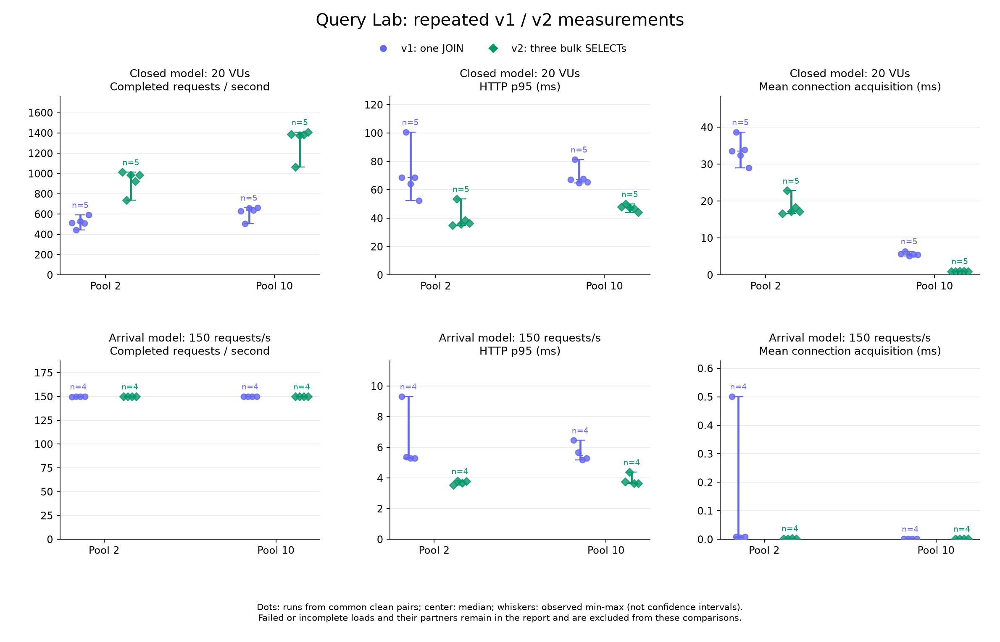

# 조회 전략 반복 측정

측정일: 2026-10-28 (Asia/Seoul), 18:55~19:29. 기존 10초·1회 탐색 결과를 **30초·5쌍의 반복 실험**으로 검증했다.

현재 데이터와 로컬 네트워크 환경에서는 v2가 동시 요청 20개의 두 풀 조건 모두에서 5쌍 전부 더 높은 처리량과 더 낮은 p95를 보였다. 풀 2개에서는 커넥션 획득 경과 시간이 응답 지연의 큰 부분이라는 관찰도 반복됐다. 다만 고정 도착률의 첫 반복에서 부하 실패 3회가 발생했으므로, 정상 상태의 성능 개선과 도착률 전달의 안정성을 구분해 해석한다.

## 범위와 고정 조건

- 데이터: 게시글 200개, 게시글당 댓글 20개·첨부파일 5개, 본문 1,024바이트, seed 42, UNIFORM.
- 조회 ID: 1~10. v1은 1 SELECT·1,000행, v2는 3 SELECT·260행이며 같은 DTO를 반환한다.
- 서버와 DB는 각각 Docker CPU 상한 2개·메모리 1 GiB. 서버 JVM heap은 256~768 MiB.
- 풀 상한 2와 10, minimumIdle은 상한과 동일. 연결 획득 timeout 1,000ms, 검증 timeout 500ms.
- 두 전략 모두 같은 읽기 전용 REPEATABLE READ 트랜잭션 경계와 MVC 코드를 사용한다. 비교 도중 이미지·코드·데이터를 바꾸지 않는다.
- 실제 이미지 ID, JVM 정보, Git 상태는 원시 결과의 runtime.json, campaign.json, resources.jsonl에 기록한다. 부하 발생기도 같은 머신 자원을 공유한다.

## 반복 설계

각 풀에서 서버를 준비한 뒤 두 전략을 각각 20초씩 VU 20으로 워밍업하고 해당 표본은 버린다. 본 실행은 다음 조건별 **30초·5쌍**, 총 60회다.

| 모델 | 부하 | 풀 | 전략 |
|---|---|---|---|
| 고정 동시성 | VU 1 | 2 / 10 | v1 / v2 |
| 고정 동시성 | VU 20 | 2 / 10 | v1 / v2 |
| 고정 도착률 | 150 req/s | 2 / 10 | v1 / v2 |

각 반복에서 조건 순서를 회전하고 두 전략의 선후 순서도 교대한다. 각 실행 전 20회 순차 워밍업도 집계에서 제외한다. 풀별 측정 블록은 2→10 순서이므로, 풀 크기 자체의 인과 효과는 시간·호스트 상태와 완전히 분리된 실험으로 해석하지 않는다. 전략 간 비교는 같은 풀·부하·반복 번호의 쌍을 사용한다.

초기 사전 부하 600 req/s는 두 전략 모두 dropped iteration이 발생해 같은 도착률의 지연 비교 대상으로 채택하지 않았다. 실제 전달을 확인한 150 req/s를 낮은 부하의 공통 비교점으로 정하고, 포화 상태는 VU 20에서 별도 관찰한다. 따라서 최대 수용 RPS나 경계 용량을 추정하는 실험은 아니다.

## 분석 기준

분석 단위는 개별 요청 수만 건이 아니라 **반복 실행 5쌍**이다. 실행별 HTTP p95/p99, 완료·성공 RPS, 커넥션 획득·점유 시간을 구하고, 다섯 실행의 중앙값과 최솟값~최댓값을 보고한다. 서로 다른 실행의 백분위를 합쳐 새로운 백분위로 부르지 않는다.

같은 반복 쌍의 v2/v1 비율과 개선 방향의 일관성을 함께 기록한다. 작은 반복 수로 과도하게 정밀한 신뢰구간이나 통계적 유의성을 주장하지 않는다. 단순한 방향뿐 아니라 절대 시간·처리량 차이와 실행 순서에 따른 변화도 확인한다.

오류·dropped·incomplete·pool timeout이 있으면 정상 지연 비교에서 제외하고 부하 실패로 별도 보존한다. 계측 실패·카운터 초기화·데이터 변경·실제 풀 설정 불일치·부하 컨테이너 정리 실패는 측정 무효로 구분한다. 부하 중 다른 요청이나 데이터 재생성을 실행하지 않는다.

커넥션 acquire는 검증과 timeout 경로 등을 포함한 획득 경과 시간이므로 순수 queue wait라고 부르지 않는다. usage와 pending도 함께 본다. pending 최대값과 CPU는 표본의 최대이며 실제 순간 최대가 아니다. CPU·GC는 원인을 점검하는 보조 관측이고, 상관관계만으로 DB 또는 GC가 원인이라고 단정하지 않는다.

## 재현

```powershell
.\benchmarks\repeat-study.ps1 -Pools 2,10 -ArrivalRate 150 -PreallocatedVus 50 -MaxVus 200 -Duration 30s -WarmupDuration 20s -WarmupRequests 20 -Repeats 5 -OutputDirectory benchmarks/results/repeated-study
node benchmarks/analyze-study.mjs --input benchmarks/results/repeated-study
```

자원 관측은 별도 터미널에서 `node benchmarks/study-monitor.mjs benchmarks/results/repeated-study`를 실행한다. 완료 후 결과 폴더에 `monitor-stop` 파일을 생성하면 종료한다. 모니터 자체의 지표 조회·Docker 통계 수집 비용도 존재한다.

실행기는 데이터·실제 풀·계측·컨테이너 정리를 검사하고 초기 풀 설정을 복원한다. 원시 실행별 JSON은 `benchmarks/results/repeated-2026-10-28/`에 보존한다.

## 결과

계획한 **60회 전부 완료**, 계측 유효 60회, 정상 57회, 부하 실패 3회다. 별도 워밍업 실행 4회는 제외했다. 정상 지연 비교에 쓸 수 있는 공통 쌍은 28쌍(56회)이며, 정상이어도 상대 전략이 실패한 한 실행은 해당 비교에서 제외했다. 실패한 실행을 재실행으로 대체하거나 워밍업으로 사후 재분류하지 않았다.

측정 요청은 823,023건 시작·완료됐고, HTTP/계약 검사 실패 1건, dropped iteration 104건, 미완료 0건, Hikari 획득 timeout 1건이었다. 요청 수는 반복 표본 수가 아니다.

아래 절대값은 **실행별 통계의 중앙값 [최솟값, 최댓값]**이다. 개선율은 같은 반복 번호의 v2/v1 비율로 계산한 뒤 중앙값을 구했다. 따라서 표에 표시된 두 중앙값을 나눈 비율과 일치하지 않을 수 있다.

### 동시 요청 20개: 처리량과 지연

| 풀 | 전략 | 공통 정상 쌍 | 완료 RPS | HTTP p95 ms | HTTP p99 ms |
|---|---|---:|---:|---:|---:|
| 2 | v1 | 5 | 514.05 [444.22, 593.84] | 68.63 [52.43, 100.73] | 98.24 [73.11, 150.69] |
| 2 | v2 | 5 | 984.44 [735.62, 1,013.66] | 36.41 [35.10, 53.61] | 55.47 [51.04, 78.01] |
| 10 | v1 | 5 | 639.08 [505.49, 664.68] | 67.29 [64.69, 81.41] | 84.15 [80.16, 153.50] |
| 10 | v2 | 5 | 1,382.30 [1,063.35, 1,409.48] | 47.52 [44.09, 50.06] | 60.44 [57.39, 72.03] |

| 풀 | 쌍별 처리량 증가 중앙값 [범위] | 쌍별 p95 감소 중앙값 [범위] | v2 유리한 쌍 |
|---|---:|---:|---:|
| 2 | 81.9% [65.6%, 97.2%] | 44.2% [30.5%, 48.9%] | 두 지표 모두 5/5 |
| 10 | 112.1% [109.0%, 120.5%] | 30.8% [26.5%, 38.5%] | 두 지표 모두 5/5 |

closed 모델의 처리량은 같은 동시성에서 실제로 완료한 양이다. 두 전략에 같은 RPS를 보낸 비교도 아니며, 서비스의 최대 수용 RPS를 구한 것도 아니다.

### 동시 요청 20개: 커넥션 획득과 점유

| 풀 | 전략 | acquire 평균 ms | usage 평균 ms | 실행별 pending 표본 최대의 중앙값 [범위] |
|---|---|---:|---:|---:|
| 2 | v1 | 33.53 [29.05, 38.69] | 3.30 [2.81, 3.90] | 18 [18, 18] |
| 2 | v2 | 17.19 [16.66, 22.82] | 1.50 [1.43, 2.11] | 18 [18, 18] |
| 10 | v1 | 5.59 [5.12, 6.43] | 13.61 [13.12, 16.91] | 10 [8, 10] |
| 10 | v2 | 0.93 [0.88, 1.08] | 4.78 [4.64, 5.73] | 8 [6, 10] |

풀 2·VU 1에서는 두 전략의 획득 평균이 약 0.001ms였지만, VU 20에서는 수십 ms로 늘었다. VU 20의 다섯 실행 모두 pending 최대 관측값이 18이었고, 획득 경과 시간이 점유 시간보다 훨씬 컸다. 실행별 acquire 평균/HTTP 평균 비율도 v1은 87.1~87.6%, v2는 85.8~86.8%였다. 서로 다른 집계창의 평균을 비교한 보조 지표로서, 요청별 추적을 통한 정확한 지연 분해나 순수 queue wait 비율은 아니다.

같은 풀·동시성 안에서 v2의 획득 평균 감소율은 풀 2에서 46.0%, 풀 10에서 83.6%, 점유 평균 감소율은 각각 52.4%, 64.6%였다(쌍별 개선율 중앙값). **SQL이 세 번이어도 같은 트랜잭션의 연결 하나를 계속 사용한다.** 이 실험에서는 추가 SELECT보다 반환 행·객체 조립 등의 작업 감소와 짧은 연결 점유가 유리하게 작용한 결과와 일관된다. 각 요인의 인과 기여율까지 분리한 실험은 아니다.

pending 최대가 같아도 대기 시간이 같다는 뜻은 아니다. 특히 풀 2에서는 양쪽 모두 pending 18에 도달했지만 v2는 더 짧게 점유하고 더 많은 요청을 완료했다.

### 단일 동시 요청과 같은 도착률

| 조건 | 풀 | 공통 정상 쌍 | v1 HTTP p95 ms | v2 HTTP p95 ms | 쌍별 p95 감소 중앙값 |
|---|---:|---:|---:|---:|---:|
| VU 1 | 2 | 5 | 4.90 [4.38, 5.46] | 2.88 [2.71, 2.97] | 39.4% |
| VU 1 | 10 | 5 | 5.00 [4.63, 6.85] | 3.06 [2.91, 3.87] | 39.3% |
| 150 req/s | 2 | 4 | 5.33 [5.29, 9.33] | 3.73 [3.53, 3.81] | 29.7% |
| 150 req/s | 10 | 4 | 5.48 [5.18, 6.46] | 3.71 [3.64, 4.39] | 30.4% |

모든 조건의 모든 정상 공통 쌍에서 v2의 p95가 낮았다. 고정 도착률의 정상 공통 쌍은 두 풀 모두 반복 2~5이며, 양쪽 모두 완료 처리량이 약 150 req/s다. 이 조건에서 미세한 RPS 차이는 처리량 우위로 해석하지 않는다. 풀 10에서는 획득 평균이 v1 약 0.0017ms, v2 약 0.0020ms로 모두 매우 작았다. 낮은 부하에서의 지연 차이를 풀 대기 감소로 일괄 설명할 수 없다.

### 실패와 초기 변동

| 풀 | 반복 | 전략 | 완료/성공 | dropped | HTTP 실패 | 획득 timeout | HTTP p99 ms |
|---|---:|---|---:|---:|---:|---:|---:|
| 2 | 1 | v2 | 4,447 / 4,446 | 53 | 1 | 1 | 549.12 |
| 10 | 1 | v2 | 4,474 / 4,474 | 27 | 0 | 0 | 400.52 |
| 10 | 1 | v1 | 4,477 / 4,477 | 24 | 0 | 0 | 342.47 |

모두 150 req/s의 첫 반복에서 발생했다. 고정 도착률 실행 20회 중 v1은 1/10, v2는 2/10회가 실패했고, 반복 2~5의 16회는 정상 완료했다. 작은 표본의 관측 빈도이며 모집단 실패율이나 전략 간 신뢰성 차이의 추정치는 아니다.

풀 2·v2의 HTTP 실패는 서버 로그에서 연결 획득 timeout으로 확인했다. 나머지 두 실행은 HTTP 오류는 없었지만 발생기가 목표 도착률의 모든 iteration을 시작하지 못했다. 실패 시 서버 CPU 최대 표본은 각각 약 27.3%, 27.5%, 57.3%였고, GC pause 근사 합계는 0.033초, 0.129초, 0.312초였다. 표본 간 순간 부하나 구간 경계는 놓칠 수 있어 CPU·GC가 원인이라고 입증하거나 배제할 수 없다. **초기 과도 상태의 가능성은 있으나 원인은 확인되지 않았다.**

세 실패를 지워서 "150 req/s를 항상 안정적으로 처리했다"고 결론내릴 수 없다. 정상 완료 구간의 성능 차이와 최초 도착률 전환에서 관찰한 실패를 함께 결과로 남긴다.

v1 선행·v2 선행 하위 그룹에서도 p95 개선 방향은 유지됐다. 각 2~3쌍이므로 순서 효과가 없다고 확정하지는 않는다. 첫 실행과 이후 실행 간 변화도 일관되지 않았다. 예를 들어 풀 10·VU 1의 v2 첫 p95는 이후 정상 반복 중앙값의 약 1.28배였으나, 다른 조건에서 같은 방향의 초기 지연이 일관되게 나타나지는 않았다.

### 자원과 결론의 범위

VU 20에서 서버 CPU 표본 중앙값은 풀 2에서 v1 161%, v2 153%, 풀 10에서 v1 202%, v2 203%였다(100%=1코어). 풀 10은 서버의 2코어 상한 부근이므로 연결 대기만으로 전체 지연을 설명하기 어렵다. Docker 표본의 200% 소폭 초과값을 정밀한 상한 위반으로 해석하지 않는다. 같은 동시성에서도 v2는 더 많은 요청을 처리하므로 CPU 절대 사용량만으로 요청당 효율을 단정할 수 없다.

풀 10으로 바꾼 블록에서 획득 지연은 줄었지만 v2 p95는 풀 2 블록보다 높게 관찰됐다. 풀 크기를 늘리면 모든 지연이 줄어든다는 결론도 성립하지 않는다. 두 풀 블록의 시간·호스트 상태가 교란돼 있어, 이 수치로 최적 풀 크기나 풀 크기의 순수 인과 효과를 확정하지 않는다.

이번 반복 결과로 지지되는 결론은 **현재 데이터의 행 증폭과 로컬 왕복 비용 아래에서는, v2가 추가 SQL 왕복을 감수해도 더 짧은 연결 점유·획득 시간과 더 나은 동시 처리 성능을 보였다**는 것이다. 특히 작은 풀의 경합 상황에서는 연결 획득 지연을 함께 관측해야 성능 차이를 설명할 수 있었다.

다만 댓글·첨부 수, 부모 수, 본문 크기를 변화시키지 않았고 인위적인 네트워크 RTT도 넣지 않았다. 따라서 행 증폭이 작은 데이터나 원격 DB에서도 v2가 항상 유리하다는 결론은 아니다. 최대 지속 도착률·최적 풀 크기·첫 도착률 반복 실패의 원인은 이번 실험으로 결정하지 않았다.

### 결과 파일과 검증

- [전체 실행 CSV](measurements/repeated-2026-10-28-runs.csv): 실패를 포함한 60회. 원본 보고서는 파일명으로 참조한다.
- [분석 상세](measurements/repeated-2026-10-28-analysis.md): 조건별 범위, 실패, 자원 및 첫 반복 비교.
- [기계 판독용 요약](measurements/repeated-2026-10-28-summary.json): 환경·완료 범위·공통 쌍 지표·순서별 효과·실패 기록.
- [원본 SHA-256 목록](measurements/repeated-2026-10-28-raw.sha256): 워밍업·측정 JSON 64개와 campaign/runtime/resources 파일의 해시. 원시 파일은 로컬 `benchmarks/results/repeated-2026-10-28/`에 보존되며 Git 제외 대상이다.
- [그래프 PDF](measurements/repeated-study.pdf): 점은 공통 정상 쌍의 개별 실행, 중심은 중앙값, 막대는 관측 최솟값~최댓값이다. 신뢰구간이 아니다.



완료 후 풀 상한·최솟값 10개, 획득 timeout 30초, 검증 timeout 500ms로 원래 설정을 복원했다. 데이터 보존과 두 API의 DTO 동등성, SELECT 1/3회, 반환 행 1,000/260개를 재확인했다. 남은 부하 컨테이너는 없고 클라이언트도 HTTP 200으로 확인했다. 분석기 테스트 12개와 실행 스크립트 구문 검사를 통과했다.
