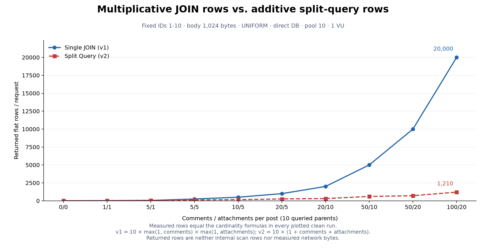
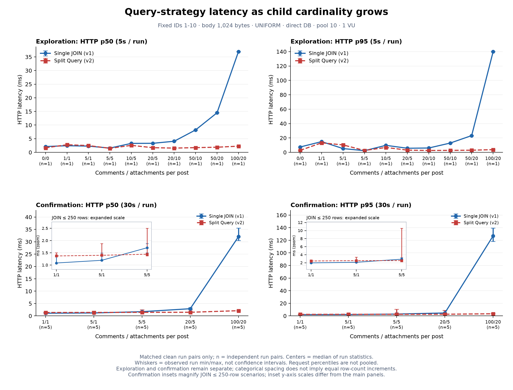

# 4차: 복수 To-Many cardinality 실측 기록

측정일은 **2026-10-30 KST**다. direct PostgreSQL 경로에서 댓글/첨부 수만 바꾸어, 같은 DTO를 만드는 단일 JOIN(v1)과 분할 조회(v2)를 비교했다. 탐색 결과와 반복 확인 결과는 별도 실행 블록으로 해석한다.

**낮은 cardinality에서는 v1의 이점이 관측됐고, 큰 cardinality에서는 v2가 일관되게 유리했다.** 다만 5/5와 20/5의 p95는 반복 방향이 섞였다. 최대 100/20은 모든 5쌍에서 v2의 p50·p95가 낮았고, p95 실행별 중앙값은 v1 126.87ms, v2 3.36ms였다. 하나의 정확한 전환점이나 보편적인 최적 전략을 정한 결과는 아니다.

## 환경과 절차

- 작업 시작 시 최신 `main`/`origin/main`의 `d8325d1`을 확인하고 `feat/4-cardinality-study`에서 작업했다. 애플리케이션 조회·계측·생성 코드는 변경하지 않았다. 반복 측정의 실행 코드 기준은 `95016b9`다.
- Windows 호스트, Intel Core Ultra 7 258V(논리 CPU 8개), Docker Desktop 4.44.3/Engine 28.3.2, WSL2 Linux VM. 컨테이너 이미지 ID와 자원 제한은 각 캠페인의 `runtime.json`에 보존했다.
- Node 22.23.2, k6 1.2.0, PostgreSQL 18.6, 서버 Java 21.0.12.1+1-LTS. 서버/DB 각각 CPU 상한 2개·메모리 1 GiB, 서버 heap 256~768 MiB다.
- 게시글 200개, 조회 ID 1~10, 본문 1,024 ASCII bytes, seed 42, UNIFORM. Hikari maximum/minimumIdle 10/10, connection timeout 30,000ms, validation timeout 500ms. VU 1 closed model, HTTP timeout 10초다.
- 실제 서버 `DB_URL=jdbc:postgresql://db:5432/querylab`을 실행 전후 검사했다. Toxiproxy·추가 인위적 latency는 사용하지 않았다. 기존 지연 실험 산출물은 보존했다.
- 모든 데이터 변경은 `/lab/dataset`으로 수행했고, 기존 생성 로직이 통계 `ANALYZE`도 수행했다. 생성 후 양 전략을 각각 10초 워밍업하고 개별 실행 전 요청 10회를 추가로 제외했다.
- 전략별로 분리 실행하며 AB/BA를 교대했다. 반복마다 시나리오 시작점을 회전하고 진행 방향도 교대했다. 데이터·DTO 해시·SELECT 수·총/개별 결과 행을 쌍 전후에 검사했다.
- 5초 간격 CPU·컨테이너 메모리·JVM heap/GC 관측에는 기존 `study-monitor.mjs`를 사용했다. 본 측정 중 이 앱/DB에 다른 HTTP 부하나 EXPLAIN·DB 프로파일링을 실행하지 않았다. 다른 프로젝트의 유휴 컨테이너와 호스트 배경 프로세스는 남아 있어 머신 전체를 격리한 실험은 아니다.

시나리오 전체의 탐색은 5초·1쌍으로 수행했다. 그 뒤 **1/1, 5/1, 5/5, 20/5, 100/20**을 30초·5쌍으로 선택했다. 낮은 cardinality, 탐색에서 지표별 우위가 섞인 경계 후보, 기존 실험의 기준 cardinality, 최대 행 증폭을 포함하기 위해서다. 전체 탐색을 5쌍 확인한 실험으로 표시하지 않는다.

## 탐색: 전체 시나리오

탐색 **20회 모두 정상·계측 유효**, 별도 시간 워밍업 20회 제외다. 각 조건은 1쌍이므로 아래 값은 변화 방향을 찾는 자료이며 안정적인 역전점의 증거가 아니다.

| 댓글/첨부 | 예상=실측 v1 행 | 예상=실측 v2 행 | v1/v2 행 | 행 감소율 | v1 p50 / p95 ms | v2 p50 / p95 ms |
|---|---:|---:|---:|---:|---:|---:|
| 0/0 | 10 | 10 | 1.000 | 0.0% | 2.12 / 7.42 | 1.65 / 2.75 |
| 1/1 | 10 | 30 | 0.333 | −200.0% | 2.43 / 14.88 | 2.79 / 13.21 |
| 5/1 | 50 | 70 | 0.714 | −40.0% | 2.28 / 5.22 | 2.48 / 10.32 |
| 5/5 | 250 | 110 | 2.273 | 56.0% | 1.55 / 2.30 | 1.47 / 2.57 |
| 10/5 | 500 | 160 | 3.125 | 68.0% | 3.28 / 9.72 | 2.55 / 6.77 |
| 20/5 | 1,000 | 260 | 3.846 | 74.0% | 3.31 / 5.66 | 1.71 / 3.08 |
| 20/10 | 2,000 | 310 | 6.452 | 84.5% | 4.06 / 6.01 | 1.55 / 2.56 |
| 50/10 | 5,000 | 610 | 8.197 | 87.8% | 8.22 / 12.90 | 1.72 / 2.72 |
| 50/20 | 10,000 | 710 | 14.085 | 92.9% | 14.50 / 23.27 | 1.88 / 2.96 |
| 100/20 | 20,000 | 1,210 | 16.529 | 94.0% | 36.93 / 139.79 | 2.26 / 3.73 |

`0/0`은 v2도 부모 10행과 빈 자식 두 쿼리(10/0/0)를 유지한다. `1/1`과 `5/1`의 음수 감소율은 분할 쪽 행이 더 많다는 뜻이다. v1은 SELECT 1회, v2는 SELECT 3회를 유지했다. 모든 측정 응답의 trend min/max/count와 별도 DTO 검사에서 공식과 일치했다.

초기 조건의 p95와 뒤쪽의 p95를 곧바로 매끄러운 cardinality 함수로 해석할 수 없다. 탐색은 작은→큰 순서의 한 번 실행이며 초기 JVM·호스트 변동이 남아 있다. 예를 들어 1/1 탐색과 이후 반복 확인의 절대값은 달라질 수 있다. 반복 확인에서는 시나리오 순서를 회전한다.

탐색 원시 지표는 [실행별 CSV](cardinality-2026-10-30-sweep-runs.csv)와 [분석 JSON](cardinality-2026-10-30-sweep-summary.json)에 있다.

## 반복 확인

**50회 모두 계측 유효·정상, 조건마다 5/5 공통 정상 쌍**이다. 별도 시간 워밍업 50회는 제외했다. 탐색을 합치면 본 측정 70회·665,877건 완료/성공 요청이며 HTTP/계약 오류, timeout, dropped, 미완료, 행/DTO 불일치는 0이다. 계획 grid와 보고서 경로 중복 검사도 통과했다. 워밍업 70회와 DB 진단·기능 검증은 이 숫자에서 제외한다.

탐색은 03:14:31~03:22:03, 반복 확인은 03:23:09~04:01:36 KST다. 아래는 **실행별 통계의 중앙값 [최솟값, 최댓값]**이다. 범위는 신뢰구간이 아니며 요청 백분위를 합치지 않았다. 한 번의 30초 실행이 반복 단위다.

| 댓글/첨부 | 전략 | HTTP p50 ms | HTTP p95 ms | 완료=성공 RPS |
|---|---|---:|---:|---:|
| 1/1 | v1 | 1.083 [1.075, 1.360] | 1.978 [1.902, 2.432] | 677.93 [552.80, 698.87] |
| 1/1 | v2 | 1.371 [1.363, 1.499] | 2.441 [2.397, 2.755] | 566.18 [506.08, 567.53] |
| 5/1 | v1 | 1.193 [1.182, 1.488] | 2.131 [2.070, 2.541] | 622.50 [515.38, 630.70] |
| 5/1 | v2 | 1.397 [1.378, 1.879] | 2.541 [2.431, 3.378] | 543.38 [406.05, 556.79] |
| 5/5 | v1 | 1.705 [1.504, 1.874] | 2.892 [2.490, 3.281] | 439.17 [405.03, 506.78] |
| 5/5 | v2 | 1.442 [1.374, 2.502] | 2.546 [2.465, 10.572] | 521.57 [239.62, 547.55] |
| 20/5 | v1 | 2.908 [2.577, 3.301] | 4.644 [3.994, 8.991] | 274.70 [210.11, 310.67] |
| 20/5 | v2 | 1.472 [1.437, 2.743] | 2.655 [2.536, 8.684] | 491.83 [230.67, 504.52] |
| 100/20 | v1 | 32.052 [30.466, 35.585] | 126.868 [118.282, 139.523] | 21.91 [19.25, 22.92] |
| 100/20 | v2 | 2.108 [2.006, 2.350] | 3.359 [3.120, 4.248] | 310.82 [270.79, 326.53] |

각 조건에서 예상/실측 행은 탐색 표와 동일했다. 반복 확인의 v2 개별 쿼리 행은 각각 `10/10/10`, `10/50/10`, `10/50/50`, `10/200/50`, `10/1000/200`이다. v1은 각각 `10`, `50`, `250`, `1000`, `20000`이다. 모든 반복에서 SELECT 1/3회를 유지했다.

### 우위 변화와 혼재

| 댓글/첨부 (JOIN 행) | p50 v1/v2 유리한 쌍 | p95 v1/v2 유리한 쌍 | 쌍별 p95 v2/v1 중앙값 [범위] |
|---|---:|---:|---:|
| 1/1 (10) | 5 / 0 | 4 / 1 | 1.239 [0.997, 1.284] |
| 5/1 (50) | 4 / 1 | 5 / 0 | 1.219 [1.074, 1.329] |
| 5/5 (250) | 1 / 4 | 2 / 3 | 0.951 [0.776, 3.452] |
| 20/5 (1,000) | 0 / 5 | 1 / 4 | 0.621 [0.303, 1.244] |
| 100/20 (20,000) | 0 / 5 | 0 / 5 | 0.0284 [0.0224, 0.0335] |

1/1은 행 증폭이 없고 오히려 v2가 세 SELECT·30행을 가져온다. v1이 두 번의 추가 SELECT 왕복과 호출 처리를 피하는 점은 낮은 p50·조회 시간과 일관된다. 다만 첫 쌍 p50 차이는 약 0.0025ms였고 p95는 v2가 약 0.0071ms 낮았다. 모든 작은 차이에 실질적 의미가 있다고 보지는 않는다.

5/1→5/5는 행 수 우위가 v1(50 대 70)에서 v2(250 대 110)로 바뀌는 인접 탐색 구간이다. 반복 중앙값의 성능 방향도 바뀌지만 **5/5는 p50 4/5, p95 3/5쌍만 v2 우위**다. p95의 v2/v1 비율은 0.776~3.452로 넓다. 20/5도 p50은 5/5쌍 v2 우위이나 p95는 한 쌍에서 반대였다. 3회차 5/5·v2 p95 10.572ms와 20/5·v2 p95 8.684ms는 정상 실행으로 보존했다. 오류나 clock-gap 검사 실패가 없었고 원인도 확정하지 못했으므로 이상치로 제거하지 않았다.

반복 방향이 전부 일치한 반대편 지점으로만 구간을 잡으면 p50은 **1/1~20/5(10~1,000 JOIN행)**, p95는 **5/1~100/20(50~20,000행)** 사이에 관측 우위 변화가 있다. 중간에 혼재 조건이 있어 좁은 임계값을 결정할 수 없다. 댓글/첨부의 조합이 달라지므로 JOIN 행 하나만으로 보편적인 전환점을 정의할 수도 없다.

최대 100/20은 전략 선행 순서 두 하위 그룹에서도 p50·p95 모두 v2 우위였다(각 3쌍/2쌍). 쌍별 p95 감소율 중앙값은 **97.16% [96.65%, 97.76%]**다. 같은 반복의 비율을 먼저 구했으므로 표의 두 중앙값을 나눈 개선율과 일치할 필요가 없다. 작은 표본의 일관성이며 모집단 우위 확률이나 신뢰구간은 아니다.

HTTP p99도 [실행별 CSV](cardinality-2026-10-30-confirm-runs.csv)에 보존했다. 100/20의 v1은 실행별 성공 요청이 580~688개로 모두 1,000개 미만이어서 `p99EnoughSamples=false`다. 나머지 확인 실행은 해당 기준 이상이지만, 이 기준이 정밀한 tail 추정을 보장하지는 않는다. p99로 역전점을 판정하지 않았다.

### 조회·JDBC·조립 구간

아래는 실행별 p50의 중앙값이다. p95와 관측 범위는 [분석 JSON](cardinality-2026-10-30-confirm-summary.json)에 있다.

| 댓글/첨부 | 전략 | fetchAndAssemble ms | jdbcExecute ms | assembly ms |
|---|---|---:|---:|---:|
| 1/1 | v1 | 0.336 | 0 | 0.00495 |
| 1/1 | v2 | 0.631 | 0 | 0.00551 |
| 5/1 | v1 | 0.429 | 0 | 0.00729 |
| 5/1 | v2 | 0.640 | 0 | 0.00758 |
| 5/5 | v1 | 0.781 | 0 | 0.01444 |
| 5/5 | v2 | 0.654 | 0 | 0.00939 |
| 20/5 | v1 | 1.777 | 1 | 0.03746 |
| 20/5 | v2 | 0.686 | 0 | 0.01592 |
| 100/20 | v1 | 30.342 | 18 | 0.90842 |
| 100/20 | v2 | 1.066 | 0 | 0.05344 |

v1의 1/1→100/20은 결과 행이 10→20,000으로 2,000배, v2는 30→1,210으로 약 40.3배다. 해당 구간 HTTP p50 실행별 중앙값은 v1 약 29.6배, v2 약 1.54배다. 행 증가와 HTTP 증가가 동반되지만 정비례하지는 않는다. 고정 요청 비용, DB 계획, JPA/JDBC 변환, 조립, JSON·HTTP 처리와 JVM 상태가 함께 반영된다. 같은 시나리오의 `posts` DTO는 양쪽이 같고, 시나리오 간에는 자식 수 증가로 최종 JSON 처리량도 자연스럽게 늘어난다.

특히 v1은 **조회 전체와 JDBC execute 구간의 증가가 최종 assembler 구간보다 절대 크다.** assembly도 늘지만 100/20의 p50 중앙값은 약 0.91ms로 fetchAndAssemble 30.34ms 전체를 설명하지 못한다. `jdbcExecuteMs`는 정수 ms여서 낮은 cardinality의 0이 실제 작업 0을 의미하지 않는다. JDBC execute 호출 시간은 PostgreSQL execution time이 아니며 결과 버퍼 처리와 관측 문맥의 영향을 받는다. 서로 다른 타이머의 p50/p95를 빼서 순수 JDBC 변환·전송·CPU 시간을 계산하지 않는다.

### 보조 자원과 연결

아래 CPU는 실행 안에서 관측한 표본 중앙값의 실행 간 중앙값(100%=1코어), GC는 실행 안 첫/마지막 표본의 누적 pause 차이 근사치다.

| 댓글/첨부 | 전략 | 서버 CPU % | DB CPU % | GC pause 근사 s / 실행 |
|---|---|---:|---:|---:|
| 1/1 | v1 | 48.18 | 27.49 | 0.026 |
| 1/1 | v2 | 50.22 | 24.34 | 0.034 |
| 5/5 | v1 | 52.69 | 34.90 | 0.134 |
| 5/5 | v2 | 51.72 | 22.12 | 0.039 |
| 20/5 | v1 | 61.03 | 45.15 | 0.377 |
| 20/5 | v2 | 50.69 | 21.83 | 0.048 |
| 100/20 | v1 | 90.95 | 40.06 | 11.418 |
| 100/20 | v2 | 48.04 | 21.91 | 0.081 |

100/20에서 v1의 GC pause 근사는 10.060~11.915초, 할당량 근사는 실행당 32.6~37.1 **십억 bytes**였다. v2의 GC는 0.071~0.101초였다. 큰 행 증폭과 함께 할당·GC 부담도 관찰됐으므로 HTTP p95를 DB 연산이나 명시적 DTO 조립만으로 설명할 수 없다. 표본 경계가 생략되고 같은 요청을 추적한 인과 분해가 아니므로 GC가 지연 증가의 몇 %를 일으켰다고 계산하지 않는다.

100/20의 v1 heap 최대 관측값은 실행별 약 174~233 MiB였다. 이는 5초 표본이므로 순간 최대나 전체 resident memory가 아니다. 서버/DB/발생기 CPU·heap·GC·할당 원시값과 누락 여부는 분석 JSON의 `runs[].resources`에 있다. 같은 VU라도 완료 RPS가 크게 다르므로 CPU 절대 사용률만으로 요청당 효율을 단정하지 않는다.

보조 모니터는 탐색 91개 기록 중 16개, 확인 461개 중 38개에 오류를 남겼다. 대부분 이미 종료된 k6 컨테이너의 `docker stats` 조회 경쟁(EOF/No such container)이었고, 확인에서는 `docker ps` 실패 1건도 있었다. JVM 표본 누락은 0이었다. 본 측정 실행 창에 포함된 오류 기록은 탐색 9개·확인 18개이며 `samplesWithErrors`와 원시 메시지를 보존했다. 자원 지표에는 이런 누락이 있으므로 순간 최대나 정밀한 자원 총량으로 해석하지 않는다. HTTP/Hikari 수집기의 polling 실패 0과는 별도다.

확인 50회 모두 sampled pending 최대는 0, 연결 timeout은 0이었다. 실행별 acquire 평균의 관측 범위는 약 0.00060~0.00173ms다. 100/20 연결 usage 평균의 실행별 중앙값은 v1 43.205ms, v2 1.207ms였다. 짧은 대기를 놓칠 수 있는 표본이지만, 이번 우위를 풀 경합 해소의 결과로 설명할 근거는 없다. v2의 SELECT 3회도 연결 하나를 재사용한다.

## 별도 PostgreSQL 진단

HTTP 캠페인 종료 뒤 **04:01:51~04:02:28 KST**에만 실행했다. 1/1, 20/5, 50/20, 100/20에서 캡처한 앱 SQL의 10개 바인딩 자리에 같은 ID를 넣었다. 각 SELECT를 `EXPLAIN (ANALYZE, BUFFERS, FORMAT JSON)`으로 3회씩, 총 48회 실행했다. 일반 결과 전송·DTO 조립이 없는 진단이며 HTTP 시간과 같지 않다. 앱의 prepared/generic plan 및 readOnly REPEATABLE READ 문맥과도 동일하다고 가정하지 않는다.

| 댓글/첨부 | v1 최상위 실제 행 | v2 최상위 실제 행(부모/댓글/첨부) | v1 EXPLAIN execution ms 중앙값 [범위] | v2 각 쿼리 execution ms 중앙값 | v1 최상위 shared hit/read |
|---|---:|---|---:|---|---|
| 1/1 | 10 | 10 / 10 / 10 | 0.145 [0.141, 0.149] | 0.029 / 0.038 / 0.037 | 7 / 0 |
| 20/5 | 1,000 | 10 / 200 / 50 | 0.348 [0.323, 0.398] | 0.029 / 0.052 / 0.041 | 44 / 0 |
| 50/20 | 10,000 | 10 / 500 / 200 | 1.342 [1.254, 1.402] | 0.028 / 0.092 / 0.056 | 68 / 0 |
| 100/20 | 20,000 | 10 / 1,000 / 200 | 2.544 [2.489, 2.750] | 0.023 / 0.133 / 0.052 | 73 / 0 |

1/1은 두 Hash Right Join이 각각 10행을 출력하며 자식 테이블을 Seq Scan했다. 20/5는 부모×첨부의 Hash Join 중간 결과 50행 뒤에 Memoize를 포함한 Nested Loop Left Join으로 1,000행을 만들었다. Memoize는 20행×50 loops, 실제 댓글 Index Scan은 20행×10 loops였다.

50/20과 100/20은 부모 Index Scan 10행 → 첨부 Index Scan 20행×10 loops → 중간 Nested Loop 200행을 만든다. 댓글 Memoize는 각각 50/100행×200 loops로, 최종 결과 10,000/20,000행을 출력했다. 그 아래 실제 댓글 Index Scan은 부모별 10 loops였다. 중간 결과와 최종 결과의 곱셈 증폭이 명확하며, Memoize로 재조회 비용을 줄여도 최종 중복 행 처리가 사라지지 않는다.

모든 진단 반복에서 shared read·temp read/write는 0, Sort 노드는 없었고 Hash batches는 1이었다. 높은 cardinality의 v2는 세 쿼리 모두 Index Scan을 사용했다. 캐시가 준비된 진단이므로 cold disk I/O나 temp spill의 성능 비교가 아니다. 노드별 rows/buffers를 더하면 중복 계산되므로 합계로 사용하지 않았다.

`pg_stat_statements`는 EXPLAIN과 분리한 전략별 HTTP 30회 전후 차이를 사용했다. 각 조건에서 v1 calls=30, v2 calls=90이었고 rows는 기대값×30과 일치했다. stats reset·entry eviction 변화나 오염 경고는 없었다.

| 댓글/첨부 | v1 반환 rows / 30요청 | v2 반환 rows / 30요청 | v1 기록 평균 실행 ms / SQL | v2 각 SQL 기록 평균 실행 ms(부모/댓글/첨부) |
|---|---:|---:|---:|---|
| 1/1 | 300 | 900 | 0.093 | 0.043 / 0.044 / 0.041 |
| 20/5 | 30,000 | 7,800 | 0.928 | 0.047 / 0.062 / 0.020 |
| 50/20 | 300,000 | 21,300 | 8.229 | 0.039 / 0.131 / 0.061 |
| 100/20 | 600,000 | 36,300 | 16.204 | 0.037 / 0.203 / 0.057 |

이 통계와 EXPLAIN 값은 서로 다른 실행·반환 처리 문맥의 수치다. 예를 들어 100/20의 v1은 EXPLAIN 2.544ms, 별도 HTTP SQL 통계 16.204ms로 달랐다. 이를 같은 지표의 모순으로 보거나 HTTP 시간에서 직접 차감하지 않는다. 누적 queryid별 원시 전후 값, 실제 SQL, 모든 계획 노드·loops·버퍼는 [진단 JSON](cardinality-2026-10-30-diagnostics.json)에 보존했다.

## 검증·실패 보존·복원

| 검증 | 결과 |
|---|---|
| 서버 Maven | 11/11 통과, PostgreSQL Testcontainers 통합 8개 포함, skipped 0 |
| client | 4/4 통과, TypeScript/Vite production build 통과 |
| benchmark Node | 78/78 통과, cardinality 분석기 20개·DB 진단 12개 및 기존 repeat/latency 포함 |
| Compose | 기본 monitoring/tools 및 latency overlay/latency-tools 구성 검사 통과 |
| PowerShell | 기존 실행기와 cardinality 실행기 전체 구문 검사 통과 |
| 기대 행 위반 기능 검증 | 기대 999 대 실제 1,000에서 계약 실패 133건, 성공 0, 실제 행 min=max=1,000·count=133 보존 |
| 기존 pool-run 기본 옵션 | 기대 행 옵션을 생략한 v1/v2 각각 1초 기능 검증 정상 |
| 최종 복원 | direct DB, 풀 10/10, timeout 30,000/500ms, 데이터 200/20/5/1024/42/UNIFORM·원본 DTO SHA-256 확인 |
| UI·정리 | nginx 화면 HTTP 200 및 경유 dataset 일치, 남은 k6 부하 컨테이너 없음, 모니터 종료·절전 방지 반환 |

실제 캠페인의 실패/timeout/불일치는 0이다. 별도 `validation/intentional-row-mismatch.json`은 실패 자료가 보존되는지 확인한 **의도적 기능 검증**이며 70회 성능 결과에 포함하지 않았다. k6 종료 코드 99는 기존 wrapper에서 1로 매핑된다. 최초 검증 명령에서 wrapper도 99일 것으로 가정한 assertion은 틀렸고, 보존된 보고서와 기존 wrapper 계약을 확인해 수정했다. 음성 대조 보고서를 재실행으로 덮어쓰지 않았다.

본 측정 코드는 `95016b9`, 최종 분석/검증 보강은 `1edfcb0`이다. 측정 종료 후 계약 실패 응답의 유한한 행 관측도 저장하도록 옮겼으며, 정상 응답이 전부인 본 캠페인의 행/시간 표본은 변경하지 않았다. 계획 누락·중복 검사와 선택적 자원 분석도 최종 분석기로 다시 실행했다. 초기 제한된 sandbox의 Node loopback 테스트 2건은 EACCES였으나 동일 코드를 권한이 허용된 환경에서 재실행하여 최종 전체 통과를 확인했다.

## 결론과 한계

이번 조건에서는 작은 cardinality에서 v1의 왕복/호출 절감 효과가 관측되고, 큰 cardinality에서는 v1의 곱셈 결과 행과 조회·JDBC·할당/GC 비용 증가가 두드러졌다. v2는 덧셈 행 증가로 같은 최종 DTO를 더 짧은 시간에 만들었다. 다만 중간 cardinality의 p95 혼재가 있어, 한 개의 정확한 역전점이나 행 수와 시간의 정비례 관계는 확인하지 못했다.

[3차 지연 실험](latency-2026-10-29-analysis.md)은 고정한 cardinality에서 추가 RTT가 커지면 분할 조회에 불리한 조건이 증가함을 보였다. 이번에는 추가 RTT 없이 결과 cardinality를 키웠을 때 단일 JOIN에 불리한 조건이 증가했다. 두 관측은 **성능이 Query Count 하나로 결정되지 않고 Round Trip 비용과 JOIN Result Cardinality의 절충에 따라 달라진다**는 해석과 일치한다. 두 실험의 절대값을 연결해 보편적인 경계식을 만들지는 않는다.

결론은 현재 QueryDSL scalar projection·assembler·정수 ms JDBC 계측, 로컬 Docker 자원·GC 설정, UNIFORM·부모 10개·본문 1,024bytes·VU 1에 한정된다. v1 assembler의 중복 객체 생성도 현재 구현의 일부다. `totalRows`는 내부 scan rows나 실제 네트워크 bytes가 아니며, 어느 타이머도 순수 DB CPU나 전송량으로 바꾸어 부르지 않았다. JSON 직렬화, 트랜잭션, 서버 스케줄링, JVM·호스트 상태의 인과 기여율은 분리하지 않았다. 5쌍의 범위는 통계적 신뢰구간이 아니고, closed-loop 완료 RPS는 동일 도착률 비교나 최대 서비스 용량이 아니다.

다음 후보는 Row width(`bodyBytes`) 변화, UNIFORM vs SKEWED, Latency × Cardinality 2차원 matrix, 동시성 증가에서의 cardinality 영향이다. 이번 작업에서는 범위를 확장하지 않았다.

## 재현과 자료

설계·검증 기준은 [CARDINALITY_STUDY.md](../CARDINALITY_STUDY.md)를 따른다. 레포지토리 루트에서 실행한다.

```powershell
docker compose up -d --build
.\benchmarks\cardinality-study.ps1 -Stage sweep -Duration 5s -Repeats 1 -WarmupDuration 10s -OutputDirectory benchmarks/results/cardinality-repro-sweep
.\benchmarks\cardinality-study.ps1 -Stage confirm -Scenarios '1/1','5/1','5/5','20/5','100/20' -Duration 30s -Repeats 5 -WarmupDuration 10s -OutputDirectory benchmarks/results/cardinality-repro-confirm
node benchmarks/analyze-cardinality.mjs --input benchmarks/results/cardinality-repro-sweep
node benchmarks/analyze-cardinality.mjs --input benchmarks/results/cardinality-repro-confirm
node benchmarks/explain-cardinality.mjs --output benchmarks/results/cardinality-repro-diagnostics

# Python 3.12 + Matplotlib 3.11.2로 생성. 새 환경이면 해당 Python에 Matplotlib 설치.
python benchmarks/plot-cardinality.py --sweep benchmarks/results/cardinality-repro-sweep/analysis.json --confirmation benchmarks/results/cardinality-repro-confirm/analysis.json --output docs/measurements/cardinality-repro

node --test benchmarks/*.test.mjs
docker compose --profile monitoring --profile tools config --quiet
docker compose -f compose.yaml -f compose.latency.yaml --profile latency-tools config --quiet
# server/: JAVA_HOME을 JDK21로 설정 후 .\mvnw.cmd test
# client/: npm ci; npm test; npm run build
```

원시 결과는 로컬 `benchmarks/results/cardinality-2026-10-30-{sweep,confirm,diagnostics,validation}/`에 보존했다. Git에서 제외되는 기존 결과 폴더를 그대로 사용하고, 이번 자료 329개를 [원시 압축 파일](cardinality-2026-10-30-raw.zip)(약 1.43 MB)과 [SHA-256 목록](cardinality-2026-10-30-raw.sha256)으로 함께 보존한다. 압축 파일의 네 디렉터리를 비어 있는 `benchmarks/results/`에 풀면 자동 분석을 다시 실행할 수 있다. 검증 로그·provenance도 포함한다. 실제로 별도 폴더에 압축을 풀어 반복 확인을 재분석했고, `analyzedAt` 외의 전체 분석 JSON이 원본과 일치함을 확인했다.

- 탐색: [CSV](cardinality-2026-10-30-sweep-runs.csv) · [분석 JSON](cardinality-2026-10-30-sweep-summary.json)
- 반복 확인: [CSV](cardinality-2026-10-30-confirm-runs.csv) · [분석 JSON](cardinality-2026-10-30-confirm-summary.json)
- DB: [진단 JSON](cardinality-2026-10-30-diagnostics.json), 원시 EXPLAIN 48개는 압축 파일 안의 diagnostics 디렉터리
- 그림: [행 수 PNG](cardinality-2026-10-30-rows.png) · [SVG](cardinality-2026-10-30-rows.svg) · [성능 PNG](cardinality-2026-10-30-latency.png) · [SVG](cardinality-2026-10-30-latency.svg)





성능 그림의 중심은 실행별 통계 중앙값, 막대는 관측 최소~최대다. 확인 실험의 작은 그림은 JOIN 250행 이하를 별도 y축 범위로 확대한 것이며, 탐색과 확인을 같은 반복 집합으로 연결하지 않았다.
