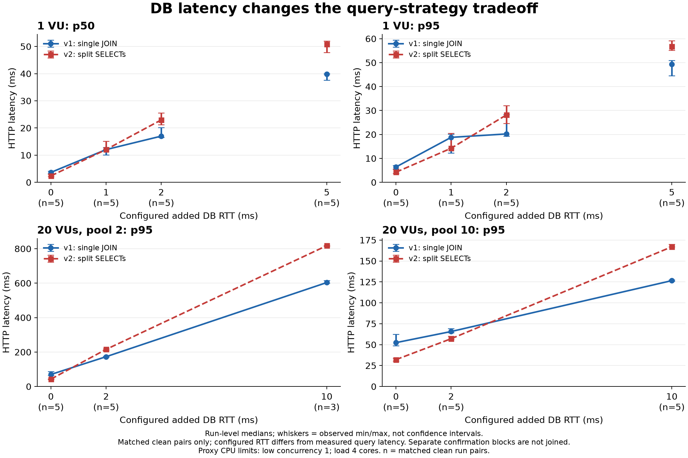

# DB 왕복 지연과 조회 전략 비교: 2026-10-29

측정일은 2026-10-29(Asia/Seoul)이다. 직전 [반복 실험](../REPEATED_STUDY.md)의 데이터와 애플리케이션을 유지하고 Application→PostgreSQL 경로에 Toxiproxy를 추가했다. 이 기록은 **경로 기준점·짧은 탐색**과 **반복 확인·동시 부하**를 구분한다. 실제 EC2–Supabase의 지연이나 성능을 측정한 결과는 아니다.

완료한 주요 캠페인 5개의 범위는 **측정 126회·계측 유효 126회·정상 122회·부하 실패 4회**다. 기준점·탐색 26회와 30초 반복 확인 100회(저부하 40회·동시 부하 60회)를 구분했다. 추가 RTT에 따라 v1/v2의 우세 방향이 달라졌지만 지연·처리량 지표가 항상 같은 전략을 선택하지는 않았다. 특히 풀 10·VU 20·RTT 2ms에서는 v1의 완료 처리량이 높고 v2의 p95가 낮았다. 정확하거나 보편적인 역전점은 확정하지 않는다. 별도로 중단한 첫 동시 부하의 4개 실행은 진단용으로 보존하고 126회에 합산하지 않았다.

## 고정 조건과 측정 방법

- 데이터: 게시글 200개, 게시글당 댓글 20개·첨부파일 5개, 본문 1,024바이트, seed 42, UNIFORM. 총 댓글 4,000개·첨부파일 1,000개다.
- 조회 ID는 1~10이다. v1은 단일 JOIN SELECT 1회·1,000행, v2는 순차 벌크 SELECT 3회·260행을 조회하며 동일한 DTO를 반환한다.
- 두 전략 모두 readOnly REPEATABLE READ 트랜잭션과 연결 하나를 사용하며 fetch size는 0이다. SELECT 3회는 커넥션 획득 3회를 뜻하지 않는다.
- 서버와 DB 각각 CPU 상한 2개·메모리 1 GiB, JVM heap 256~768 MiB다. PostgreSQL은 `18.6-bookworm`, Toxiproxy는 `2.13.0`이다. 완료한 저부하 단계와 중단한 첫 동시 부하 시도에서 프록시 CPU 상한은 1개였다. 동시 부하 재시도에서는 프록시 CPU 상한을 4개로 늘렸고 메모리는 256 MiB로 유지한다. 부하 발생기와 프록시도 같은 호스트 자원을 공유한다. 두 자원 조건은 같은 실험 단계로 합치지 않는다.
- 경로 기준점·탐색은 풀 10개·minimumIdle 10개·VU 1이다. 커넥션 획득 timeout 1,000ms, 검증 timeout 500ms, HTTP timeout 10초를 사용한다. 고정 도착률 부하는 실행하지 않는다.
- 주입값 R은 **추가 RTT 설정값**이다. upstream `floor(R/2)`ms, downstream `ceil(R/2)`ms, jitter 0·toxicity 1로 설정한다. 지연 0인 방향의 own toxic은 제거한다. R=0은 동일한 프록시를 통과하지만 latency toxic이 없는 경로다.
- 별도 Java 프로세스의 `toxiproxy-java 2.1.7`로 프록시를 제어한다. 실제 조회 코드는 변경하지 않았다. 각 실행 전후 프록시 설정·데이터·실제 풀 크기·부하 컨테이너 정리를 검사한다.
- 서버 세대가 바뀌면 해당 조건의 두 전략을 각각 10초씩 워밍업하고 버린다. 각 실행 앞의 순차 요청 10회와 별도 DTO 동등성 검사도 측정에서 제외한다. 설정 순서를 반복마다 회전하고 전략의 AB/BA 순서를 교대한다.

분석 단위는 개별 HTTP 요청이 아닌 **완결된 실행의 반복 쌍**이다. 반복 결과는 실행별 통계의 중앙값과 관측 최솟값~최댓값으로 요약한다. 서로 다른 실행의 p95를 합쳐 전체 요청의 p95라고 부르지 않는다. v1/v2 모두 정상인 같은 반복 쌍을 비교하며 실패가 발생하면 원시 기록에 보존한다.

VU 1·20은 고정 동시성이다. 응답이 느려지면 도착률도 낮아지므로 같은 VU가 같은 RPS를 뜻하지 않는다. 완료 RPS는 시나리오 시작부터 마지막 진행 중 요청의 종료까지를 분모로 한다. 이 결과로 최대 지속 수용 RPS를 추정하지 않는다. `fetchAndAssembleMs`는 트랜잭션 진입·종료 전체를 포함하지 않으며 `jdbcExecuteMs`는 순수 DB 실행 시간이 아니다. HTTP 지연과 Hikari usage/acquire를 함께 해석한다.

전체 설계와 실행 절차는 [LATENCY_STUDY.md](../LATENCY_STUDY.md)에 있다. 실행 환경의 실제 이미지 ID·CPU/메모리 설정은 캠페인별 `runtime.json`에 보존한다.

## 실행 범위

| 단계 | 경로·추가 RTT ms | 풀·부하 | 실행 시간·반복 | 측정 실행 | 반영 상태 |
|---|---|---|---|---:|---|
| 경로 기준점 | direct / proxy 0 | 풀 10·VU 1 | 10초·3쌍 | 12 | 완료·전부 정상 |
| 탐색 | proxy 0, 1, 2, 5, 10, 20, 50 | 풀 10·VU 1 | 10초·1쌍 | 14 | 완료·전부 정상 |
| 반복 확인 | proxy 0, 1, 2 | 풀 10·VU 1 | 30초·5쌍 | 30 | 완료·전부 정상 |
| 추가 확인 | proxy 5 | 풀 10·VU 1·별도 JVM 블록 | 30초·5쌍 | 10 | 완료·전부 정상 |
| 첫 동시 부하 시도·진단 | proxy 0, 2까지 기록 | 풀 2·VU 20·프록시 CPU 상한 1개 | 30초·각 1쌍 완료 | 4 | 중단·주요 비교에서 제외 |
| 동시 부하 재시도 | proxy 0, 2, 10 | 풀 2/10·VU 20·프록시 CPU 상한 4개 | 30초·5쌍 | 60 | 완료·계측 유효 60·정상 56·부하 실패 4 |

경로 기준점은 02:58:47~03:04:44, 탐색은 03:05:04~03:13:15, 0~2ms 반복 확인은 03:13:32~03:33:05, 별도 5ms 확인은 03:33:28~03:40:55에 실행했다. 동시 부하 재시도는 04:33:29~05:11:08이다. 주요 캠페인 5개에서 요청 **844,085건을 시작·완료했으며 844,081건이 성공**했다. HTTP 실패 4건·Hikari 획득 timeout 4건이 같은 실패 실행에서 발생했고, dropped iteration과 미완료는 0이다. 요청 수는 독립 반복 수가 아니다.

| 주요 캠페인 | 시작 / 완료 요청 | 성공 요청 | 제외한 시간 워밍업 실행 |
|---|---:|---:|---:|
| 경로 기준점 | 38,523 / 38,523 | 38,523 | 8 |
| 탐색 | 8,268 / 8,268 | 8,268 | 14 |
| 0~2ms 반복 확인 | 120,886 / 120,886 | 120,886 | 6 |
| 별도 5ms 확인 | 6,551 / 6,551 | 6,551 | 2 |
| 동시 부하 재시도 | 669,857 / 669,857 | 669,853 | 12 |
| **합계** | **844,085 / 844,085** | **844,081** | **42** |

완료한 주요 캠페인 5개 모두 시작·종료 데이터가 같았고 종료 시 서버 경로·풀 설정 복원 실패가 없었다. 별도 정합성 검사는 기준점 2조건·탐색 7조건·0~2ms 확인 3조건·5ms 확인 1조건·동시 부하 6조건 모두 통과했다. 중단한 첫 동시 부하의 진단 실행 4개와 시간 워밍업 4개는 위 합계에 포함하지 않았다.

## 경로 기준점: direct와 proxy 0ms

경로별 10초·3쌍이다. 아래는 **실행별 통계의 중앙값 [최솟값, 최댓값]**이다. 두 경로를 세 번씩 확인했으며, 이 표의 직접 연결/프록시 차이를 보편적인 프록시 오버헤드 상수로 사용하지 않는다.

| 경로 | 전략 | HTTP p50 ms | HTTP p95 ms | 완료 RPS | usage 평균 ms |
|---|---|---:|---:|---:|---:|
| direct | v1 | 2.70 [2.39, 2.88] | 4.79 [4.43, 5.21] | 292.00 [276.77, 316.90] | 1.89 [1.66, 1.98] |
| direct | v2 | 1.43 [1.40, 1.68] | 3.02 [2.87, 3.45] | 503.10 [433.26, 503.60] | 0.63 [0.60, 0.83] |
| proxy 0 | v1 | 3.77 [3.71, 3.84] | 6.31 [6.02, 6.58] | 218.40 [218.00, 226.88] | 3.04 [2.85, 3.06] |
| proxy 0 | v2 | 2.89 [2.66, 3.10] | 4.79 [4.45, 5.24] | 284.40 [267.75, 310.81] | 1.93 [1.82, 2.10] |

두 경로 각각의 세 쌍 모두에서 v2의 p95가 낮았다. 쌍별 p95 차이(v2−v1)는 direct에서 -1.56 [-2.19, -1.33]ms, proxy 0에서 -1.52 [-2.13, -0.78]ms였다. 프록시 경유 자체와 호스트 상태에 따른 절대값 차이가 있으므로, 지연 증가의 비교 기준은 같은 프록시 경로의 0ms로 잡는다. 직접 연결과 프록시 경로를 전환할 때 서버가 다시 시작되며 각 서버 세대에서 워밍업했다.

원시 결과와 자동 분석: [기준점 결과 전체 디렉터리](../../benchmarks/results/latency-2026-10-29-baseline/) · [campaign.json](../../benchmarks/results/latency-2026-10-29-baseline/campaign.json) · [analysis.md](../../benchmarks/results/latency-2026-10-29-baseline/analysis.md) · [실행별 CSV](../../benchmarks/results/latency-2026-10-29-baseline/runs.csv).

## 탐색: 풀 10·VU 1·10초·1쌍

다음은 설정별 **각 전략 한 번의 실행값**이다. 반복 요약이나 검증 완료 결과로 해석하지 않는다.

| 추가 RTT ms | v1 p50 ms | v2 p50 ms | v1 p95 ms | v2 p95 ms | v1 완료 RPS | v2 완료 RPS |
|---:|---:|---:|---:|---:|---:|---:|
| 0 | 4.90 | 2.72 | 7.73 | 4.76 | 176.86 | 297.90 |
| 1 | 10.24 | 12.06 | 13.38 | 14.78 | 90.33 | 77.38 |
| 2 | 20.23 | 21.40 | 28.51 | 25.64 | 45.10 | 44.10 |
| 5 | 35.44 | 49.21 | 45.05 | 57.60 | 26.77 | 19.71 |
| 10 | 65.44 | 83.89 | 74.85 | 91.99 | 14.94 | 11.65 |
| 20 | 111.25 | 159.41 | 123.34 | 164.62 | 8.74 | 6.25 |
| 50 | 266.35 | 369.21 | 273.01 | 375.52 | 3.72 | 2.69 |

탐색에서는 0ms의 v2 우위에 비해 1ms에서 p50/p95 모두 v1이 낮았다. 2ms에서는 p50과 p95의 방향이 일치하지 않았으며 p95만 v2가 낮았다. 조건별 1회이므로 이를 2ms 부근의 재역전으로 결론내리지 않는다. 특히 50ms에서는 완료 요청이 v1 38건·v2 27건에 불과해 짧은 실행의 꼬리 백분위에는 큰 표본 제약이 있다.

이 탐색은 작은 추가 RTT에서도 전략 차이가 바뀔 가능성을 확인하고, 0·1·2ms를 30초·5쌍으로 다시 측정할 조건을 고르는 데 사용한다. 5ms 이상 관측도 탐색 범위에 두며 정확한 역전점이나 실제 환경의 성능을 추정하지 않는다. `v2의 추가 왕복 비용 ≈ 2 × 추가 RTT`는 설명용 가설이며, 이 API 응답 시간을 SELECT 횟수만으로 분해하지 않는다.

원시 결과와 자동 분석: [탐색 결과 전체 디렉터리](../../benchmarks/results/latency-2026-10-29-exploration/) · [campaign.json](../../benchmarks/results/latency-2026-10-29-exploration/campaign.json) · [analysis.md](../../benchmarks/results/latency-2026-10-29-exploration/analysis.md) · [실행별 CSV](../../benchmarks/results/latency-2026-10-29-exploration/runs.csv). 탐색 단계의 자원 표본은 같은 디렉터리의 `resources.jsonl`에 있다.

## SELECT 1 교정

교정은 각각의 **재사용 JDBC 연결**에서 direct와 proxy를 비교했다. pgJDBC 42.7.14, autoCommit false·readOnly·REPEATABLE READ·fetch size 0을 사용하고, 연결당 10회 워밍업 후 30회 표본을 수집했다. direct→proxy와 proxy→direct 순서를 교대하며 순차 실행했다. 연결 생성·트랜잭션 시작·워밍업·rollback·연결 종료는 집계에서 제외했다.

아래 차이는 `proxy 표본 중앙값 − direct 표본 중앙값`이다. 프록시 경유 비용과 스케줄링을 포함하며 순수 네트워크 RTT가 아니다. 앱 경로 열은 교정 당시 애플리케이션의 경로이고, 모든 교정 자체는 direct/proxy 양쪽을 측정했다.

| 단계·앱 경로 | 추가 RTT 설정 ms | direct 중앙값 ms | proxy 중앙값 ms | 중앙값 차이 ms |
|---|---:|---:|---:|---:|
| 기준점·direct | 0 | 0.202 | 0.344 | 0.142 |
| 기준점·proxy | 0 | 0.235 | 0.472 | 0.237 |
| 탐색·proxy | 0 | 0.576 | 1.005 | 0.428 |
| 탐색·proxy | 1 | 0.414 | 1.927 | 1.513 |
| 탐색·proxy | 2 | 0.304 | 2.955 | 2.651 |
| 탐색·proxy | 5 | 0.359 | 6.282 | 5.923 |
| 탐색·proxy | 10 | 0.415 | 11.296 | 10.881 |
| 탐색·proxy | 20 | 1.012 | 22.541 | 21.529 |
| 탐색·proxy | 50 | 0.652 | 52.084 | 51.432 |
| 0~2ms 반복 확인·proxy | 0 | 0.267 | 0.494 | 0.228 |
| 0~2ms 반복 확인·proxy | 1 | 0.290 | 1.616 | 1.327 |
| 0~2ms 반복 확인·proxy | 2 | 0.775 | 3.683 | 2.908 |
| 별도 5ms 확인·proxy | 5 | 0.439 | 6.476 | 6.037 |

작은 지연에서는 설정값과 관측된 중앙값 차이를 동일시할 수 없다. 탐색에서 설정 1ms의 관측 차이는 약 1.51ms, 설정 2ms는 약 2.65ms였고, 반복 확인에서는 각각 약 1.33ms·2.91ms였다. 작은 쿼리의 교정값을 전체 API의 네트워크 비용이나 실제 배포 환경의 RTT로 대체하지 않는다. TCP 스트림의 버퍼·타이머와 트랜잭션 제어 메시지 등이 있으므로 SQL마다 정확히 한 번 R ms가 붙는다고 가정하지 않는다.

전체 표본·p95·쌍별 차이·프록시 전후 설정은 각 원시 디렉터리의 `calibration-*.json`에 있다. 교정값을 이용해 서로 다른 요청의 HTTP p95에서 지연을 빼거나 정확한 역전점을 계산하지 않았다.

## 반복 확인: 풀 10·VU 1·30초·5쌍

추가 RTT 0·1·2ms를 각각 30초·5쌍 측정했다. **30회 모두 계측 유효·정상**이며 모든 조건에서 5/5 공통 정상 쌍을 확보했다. 아래는 실행별 통계의 중앙값 [최솟값, 최댓값]이다. 탐색의 10초·1쌍을 여기에 합치지 않았다.

| 추가 RTT ms | 전략 | HTTP p50 ms | HTTP p95 ms | 완료 RPS | acquire 평균 ms | usage 평균 ms |
|---:|---|---:|---:|---:|---:|---:|
| 0 | v1 | 3.66 [3.36, 4.11] | 6.41 [5.46, 7.07] | 223.49 [202.61, 247.03] | 0.0007 [0.0006, 0.0016] | 3.03 [2.67, 3.29] |
| 0 | v2 | 2.37 [2.19, 2.98] | 4.24 [3.75, 5.57] | 336.51 [269.63, 360.55] | 0.0008 [0.0006, 0.0008] | 1.65 [1.49, 2.23] |
| 1 | v1 | 12.05 [10.12, 12.77] | 18.79 [12.28, 20.11] | 73.25 [69.44, 92.24] | 0.0020 [0.0013, 0.0022] | 11.63 [9.29, 12.24] |
| 1 | v2 | 12.07 [12.04, 15.16] | 14.24 [14.18, 20.46] | 78.03 [61.73, 78.44] | 0.0015 [0.0008, 0.0021] | 11.09 [11.04, 13.86] |
| 2 | v1 | 17.01 [16.53, 20.11] | 20.21 [19.36, 28.31] | 55.87 [45.99, 57.52] | 0.0024 [0.0023, 0.0044] | 16.18 [15.68, 19.34] |
| 2 | v2 | 22.99 [21.25, 25.60] | 28.14 [24.66, 32.08] | 41.93 [36.91, 44.87] | 0.0041 [0.0030, 0.0058] | 21.88 [20.36, 24.40] |

아래 차이는 같은 반복 번호의 v2−v1을 구한 뒤 그 5개 값을 요약한 것이다. 따라서 위 표의 두 중앙값을 뺀 값과 일치하지 않을 수 있다. 우위 쌍 수는 각 지표의 값이 낮았던 전략으로 집계했다.

| 추가 RTT ms | 쌍별 p50 차이 ms | p50 우위 쌍 v1 / v2 | 쌍별 p95 차이 ms | p95 우위 쌍 v1 / v2 |
|---:|---:|---:|---:|---:|
| 0 | -1.42 [-1.92, -0.47] | 0 / 5 | -2.17 [-3.22, 0.03] | 1 / 4 |
| 1 | -0.01 [-0.73, 5.04] | 2 / 3 | -4.55 [-5.87, 8.18] | 2 / 3 |
| 2 | 5.92 [1.14, 9.06] | 5 / 0 | 7.93 [-3.64, 12.61] | 4 / 1 |

추가 0ms의 p50은 5쌍 모두 v2가 낮았고, 2ms의 p50은 5쌍 모두 v1이 낮았다. 1ms의 실행별 p50 중앙값은 v1 12.054ms·v2 12.071ms로 거의 같았으며 쌍별 방향도 섞였다. 따라서 현재 조건의 p50에서 우세 방향이 달라지는 구간은 **설정 추가 RTT 0~2ms 사이에서 관측**했으나 정확한 임계값을 계산하지 않는다. 0.5ms 등의 미측정 설정이나 실제 네트워크 RTT로 환산하지 않는다.

p95는 0·1·2ms 각각 v2 우위 4/5·3/5·1/5쌍이었고, 어느 조건도 모든 반복의 방향이 일치하지 않았다. 따라서 p95에 대해서는 일관된 두 우세 조건으로 둘러싸인 역전 구간을 확인하지 못했다. 탐색의 2ms에서 v2 p95가 낮았던 한 번의 관측도 재현 가능한 역전으로 채택하지 않는다.

모든 조건에서 pending 최대 관측값은 0이고 평균 acquire는 작은 수준이었다. 이는 저부하 결과이며, 관측된 차이를 풀 대기만으로 설명하지 않는다. pending은 표본 gauge여서 0 관측 자체가 대기 부재를 증명하지는 않는다.

원시 결과와 자동 분석: [0~2ms 반복 확인 전체 디렉터리](../../benchmarks/results/latency-2026-10-29-confirmation/) · [campaign.json](../../benchmarks/results/latency-2026-10-29-confirmation/campaign.json) · [analysis.md](../../benchmarks/results/latency-2026-10-29-confirmation/analysis.md) · [실행별 CSV](../../benchmarks/results/latency-2026-10-29-confirmation/runs.csv).

## 추가 확인: 별도 5ms 블록·풀 10·VU 1

0~2ms 확인에서 p95의 쌍별 방향이 섞인 결과를 보고, 추가 RTT 5ms를 30초·5쌍으로 확인하는 조건을 추가했다. **10회 모두 계측 유효·정상**이며 공통 정상 쌍은 5/5다. 시간 워밍업 2회는 제외했고 데이터 보존·서버 복원을 확인했다.

아래는 이 블록 안의 실행별 통계 중앙값 [최솟값, 최댓값]이다.

| 전략 | HTTP p50 ms | HTTP p95 ms | 완료 RPS | acquire 평균 ms | usage 평균 ms |
|---|---:|---:|---:|---:|---:|
| v1 | 39.87 [37.66, 39.97] | 49.31 [44.52, 50.94] | 23.80 [23.71, 25.78] | 0.0126 [0.0108, 0.0155] | 38.95 [35.75, 39.12] |
| v2 | 50.86 [47.76, 52.03] | 56.80 [55.11, 59.11] | 19.08 [18.58, 20.41] | 0.0143 [0.0137, 0.0175] | 49.53 [46.46, 50.44] |

p50과 p95 모두 **5쌍 전부 v1이 낮았다**. 쌍별 차이(v2−v1)는 p50 10.99 [8.04, 12.07]ms, p95 8.87 [5.86, 11.67]ms였다. 이 블록의 고정 5ms 조건에서는 반복 방향이 일치했으나, 0ms부터 5ms까지의 모든 조건에서 p95가 단조롭게 바뀌거나 하나의 정확한 임계값을 가진다는 증거는 아니다.

이는 앞선 결과에 따라 선택한 추가 실험이고, 서버가 다시 시작된 별도 JVM 블록이다. 원래 0~2ms 캠페인에 같은 블록의 추가 반복처럼 합치지 않으며, 그림에서도 그 선을 5ms까지 이어 하나의 연속 측정 곡선으로 표시하지 않는다. 블록 사이의 호스트·JVM 상태 차이까지 주입 지연만의 효과로 단정하지 않는다.

원시 결과와 자동 분석: [별도 5ms 확인 전체 디렉터리](../../benchmarks/results/latency-2026-10-29-confirmation-5ms/) · [campaign.json](../../benchmarks/results/latency-2026-10-29-confirmation-5ms/campaign.json) · [analysis.md](../../benchmarks/results/latency-2026-10-29-confirmation-5ms/analysis.md) · [실행별 CSV](../../benchmarks/results/latency-2026-10-29-confirmation-5ms/runs.csv).

## 첫 동시 부하 시도: 중단·진단용 기록

첫 동시 부하는 03:41:23에 프록시 CPU 상한 1개로 시작했다. 풀 2·추가 RTT 0ms와 2ms에서 첫 반복의 두 전략을 각각 완료해 **측정 보고서 4개·시간 워밍업 보고서 4개**가 남았다. 완료한 4개 측정은 데이터·풀·프록시·계측 검사를 통과했고, HTTP/계약 오류·dropped·미완료·획득 timeout은 0이었다. 이 4개 실행의 시작·완료·성공 요청은 각각 18,436건이다. 그러나 캠페인 전체는 미완료이며 이 실행들은 **주요 측정 126회와 합치지 않고 진단 기록으로만 보존**한다.

| 기록된 조건 | 측정 보고서 | 시간 워밍업 보고서 | 주요 비교 반영 |
|---|---:|---:|---|
| 풀 2·RTT 0ms·첫 반복 v1/v2 | 2 | 2 | 제외·진단용 |
| 풀 2·RTT 2ms·첫 반복 v1/v2 | 2 | 2 | 제외·진단용 |

프록시 자원 표본을 점검한 결과, RTT 0ms·풀 2·v1의 측정 구간에서 프록시 CPU 표본 6개가 **94.88~104.03%, 평균 99.94%**였다. Docker CPU의 100%는 코어 1개이며 당시 상한도 1개였다. 따라서 프록시 자체가 추가 병목이 됐을 가능성을 고려해야 한다. 이 표본으로 cgroup throttling을 입증하지는 않는다. 약 5초 간격의 수집 표본이고 실제 throttling counter는 수집하지 않았다. 100% 소폭 초과값도 정밀한 자원 상한 위반으로 해석하지 않는다.

이와 별도로 Windows System 이벤트에는 **03:46:05 Kernel-Power 42, 사유 Battery**가 기록됐고, **04:27:23 최대 절전 모드에서 재개**한 기록이 있었다. 공백은 보고서가 완료되지 않은 RTT 10ms 워밍업 도중에 발생했다. 공백 이후 완료한 측정 보고서는 없었다. 따라서 장시간 정지를 포함한 요청을 정상 실행처럼 분석하거나, 완료하지 않은 10ms 조건을 측정 결과로 채우지 않는다.

중단 시 프로세스 강제 종료로 실행기의 `finally`와 종료 메타데이터 저장이 끝나지 않아 최초 `campaign.json`은 `running` 상태로 남았다. 이후 해당 캠페인을 **`aborted`로 기록**하고 수동 복원 내역을 `manualRecovery`에 추가했다. 원시 4개 실행과 중단 이유를 보존했으며 현재 진행 중인 캠페인이 아니다. 서버의 DB 경로를 direct로, 풀 상한/최솟값을 10/10으로, 획득/검증 timeout을 30,000/500ms로 수동 복원했고 데이터가 그대로임을 확인했다. 자동 복원 성공과 수동 복원을 구분한다.

참고로 앞선 VU 1 반복 확인의 **워밍업·유휴 시간을 포함한 캠페인 전체 자원 파일**에서 프록시 CPU 표본 235개는 평균 27.46%·최댓값 73.48%였다. 이는 측정 실행 구간만 골라 낸 평균이 아니며 저부하에서 throttling이나 순간 포화가 없었다는 증명도 아니다. 첫 동시 부하의 포화 의심을 저부하 결과 전체의 무효로 확대하거나, 반대로 이 표본으로 동시 부하의 병목을 배제하지 않는다.

진단 원시 경로: [중단한 첫 동시 부하 전체 디렉터리](../../benchmarks/results/latency-2026-10-29-load/) · [campaign.json](../../benchmarks/results/latency-2026-10-29-load/campaign.json) · [자원 원시 표본](../../benchmarks/results/latency-2026-10-29-load/resources.jsonl). 파일 기반 프록시 점검은 [latency-load-proxy-audit.json](../../.cache/latency-load-proxy-audit.json)에 보존했다.

## 동시 부하 재시도: 풀 2/10·VU 20·프록시 CPU 상한 4개

프록시 CPU 상한을 4개로 늘리고 추가 RTT 0·2·10ms·풀 2/10·VU 20을 각각 30초·5쌍 측정했다. 서버와 DB의 자원 상한은 유지했다. 계획한 **60회 전부 계측 유효·정상 56회·부하 실패 4회**로 완료했으며 캠페인 상태는 `completed_with_load_failures`다. 모든 실패는 아래 풀 2·RTT 10ms의 4회이며 실패를 재실행으로 대체하지 않았다.

일시적인 절전 방지 요청을 적용하고 시작·종료 전원 상태를 저장했다. Windows 전원 API에서 AC 연결 상태는 두 시점 모두 1, 배터리는 시작 7%·종료 31%였다. 절전 방지 요청은 동일 스레드 37676에서 획득·반환했고 `sleepPrevention.restored=true`를 확인했다. 이 시작·종료 표본을 실행 중 모든 순간의 전원 상태 증거로 사용하지 않는다.

저부하의 추가 왕복 비용과 경합 상황의 풀 대기 증가를 구분하며, 서로 다른 풀을 실행한 시간 블록의 차이까지 풀 크기만의 인과 효과로 단정하지 않는다. 저부하 확인은 프록시 CPU 상한 1개, 이번 동시 부하는 4개로 **단계의 자원 조건이 다르다**. 따라서 두 단계의 차이를 동시성이나 풀 크기 하나만의 인과 효과로 해석하지 않고, 재시도 단계 내부의 같은 자원 조건에서 전략을 비교한다.

전체 60개 측정 실행에 대한 [프록시 CPU 점검](../../benchmarks/results/latency-2026-10-29-load-proxy4cpu/proxy-cpu-audit.json)은 각 실행의 `observationWindow` 안에 있는 표본 378개를 확인했다. 실행 밖이나 측정 완료 후에 수집한 모니터 표본은 이 계산에서 제외했다. 프록시 표본이 전혀 없는 실행은 0개였고, 전체 최대 CPU는 **180.97%**였다(풀 10·RTT 0ms·v1·반복 5). 상한 4개 코어에 해당하는 400%의 90%인 360%에 도달한 실행은 0개였다. 첫 RTT 0ms·풀 2·v1의 평균 116.16%·최대 140.27%도 이 점검에 포함된다. 관측한 표본에서는 프록시 상한 부근의 포화가 나타나지 않았으나, 약 5초 간격의 표본이며 cgroup counter는 없어 순간 포화나 throttling의 부재를 증명하지 않는다.

### 풀 2 블록

풀 2의 계획한 **30회는 전부 계측 유효**다. 이 중 정상 26회·부하 실패 4회이며 시간 워밍업 6회는 제외했다. RTT 0·2ms는 각각 5/5 공통 정상 쌍, 10ms는 3/5 공통 정상 쌍이다.

아래는 같은 반복의 두 전략이 모두 정상인 쌍만 사용한 **실행별 통계의 중앙값 [최솟값, 최댓값]**이다. 실패 실행을 제거한 뒤 반복을 다시 채우지 않았다.

| 추가 RTT ms | 전략 | 공통 정상 쌍 | HTTP p50 ms | HTTP p95 ms | 완료 RPS | acquire 평균 ms | usage 평균 ms |
|---:|---|---:|---:|---:|---:|---:|---:|
| 0 | v1 | 5 | 42.02 [40.67, 50.70] | 70.06 [65.89, 87.63] | 430.69 [358.12, 449.11] | 40.59 [38.89, 48.80] | 4.08 [3.89, 4.99] |
| 0 | v2 | 5 | 24.64 [23.76, 25.73] | 43.09 [40.20, 45.14] | 715.18 [711.57, 759.54] | 24.13 [22.72, 24.27] | 2.24 [2.09, 2.27] |
| 2 | v1 | 5 | 156.36 [155.22, 157.67] | 173.11 [170.74, 175.56] | 125.61 [125.08, 126.65] | 141.94 [140.76, 142.48] | 15.37 [15.24, 15.42] |
| 2 | v2 | 5 | 194.47 [193.37, 194.66] | 215.70 [208.75, 217.74] | 101.12 [100.86, 101.96] | 176.43 [174.93, 176.85] | 19.21 [19.05, 19.26] |
| 10 | v1 | 3 | 590.67 [589.18, 591.46] | 603.51 [600.46, 615.41] | 33.80 [33.65, 33.96] | 526.26 [523.89, 528.48] | 58.61 [58.33, 58.85] |
| 10 | v2 | 3 | 785.81 [780.44, 794.36] | 817.75 [812.19, 820.82] | 25.25 [25.06, 25.46] | 701.97 [696.81, 707.61] | 78.56 [77.98, 79.21] |

0ms에서는 p50·p95·완료 RPS 모두 5쌍 전부 v2가 유리했고, 2ms에서는 세 지표 모두 5쌍 전부 v1이 유리했다. 10ms의 정상 3쌍에서도 세 지표 모두 v1이 유리했지만 아래의 실패와 실행 순서 제한을 함께 보아야 한다. 정상 쌍의 pending 최대 관측값은 두 전략·세 지연 조건 모두 18이었다. acquire 경과 시간이 usage보다 크게 나타나므로 HTTP 지연을 추가 SQL 왕복 시간만으로 설명하지 않는다. acquire는 순수 queue wait가 아니다.

10ms의 반복 2·4에서는 **두 전략 각각 획득 timeout 1건과 HTTP 실패 1건**이 발생했다. 이는 계측 무효가 아니라 유효하게 기록한 부하 실패 4회·timeout 요청 4건이다. dropped·미완료는 없었다. 실패한 실행과 원시 보고서는 보존하고 정상 지연 표에서만 제외한다.

| 반복 | 전략 | 완료 / 성공 요청 | HTTP 실패 요청 | 획득 timeout |
|---:|---|---:|---:|---:|
| 2 | v2 | 776 / 775 | 1 | 1 |
| 2 | v1 | 1,042 / 1,041 | 1 | 1 |
| 4 | v2 | 775 / 774 | 1 | 1 |
| 4 | v1 | 1,052 / 1,051 | 1 | 1 |

AB/BA 교대 설계상 10ms에서 정상인 반복 1·3·5는 모두 **v1 선행**이었고, 제외한 반복 2·4는 모두 **v2 선행**이었다. 따라서 정상 3쌍의 지연 요약에는 실행 순서에 따른 선택이 남아 있다. 이 관측만으로 v2 선행이 실패를 일으켰다고 결론내리지 않는다. 순서와 초기 상태 등 가능한 요인을 분리한 실험이 아니며, 실패를 재실행으로 대체하지도 않았다. 정상 3쌍의 v1 우위를 모든 실행 순서·신뢰성 조건의 우위로 확대하지 않는다.

### 풀 10 블록

계획한 **30회 모두 계측 유효·정상**이며 모든 RTT에서 5/5 공통 정상 쌍을 확보했다. 시간 워밍업 6회는 제외했다. HTTP/계약 오류·획득 timeout·dropped·미완료는 0이었다. 아래는 실행별 통계 중앙값 [최솟값, 최댓값]이다.

| 추가 RTT ms | 전략 | HTTP p50 ms | HTTP p95 ms | 완료 RPS | acquire 평균 ms | usage 평균 ms |
|---:|---|---:|---:|---:|---:|---:|
| 0 | v1 | 29.53 [27.55, 33.22] | 52.43 [48.60, 62.28] | 623.57 [546.97, 672.57] | 13.74 [12.73, 15.78] | 15.20 [14.04, 17.40] |
| 0 | v2 | 12.67 [11.62, 13.00] | 32.14 [30.66, 33.85] | 1,261.56 [1,215.09, 1,357.46] | 5.33 [4.88, 5.47] | 7.06 [6.49, 7.36] |
| 2 | v1 | 42.09 [40.84, 42.63] | 65.72 [64.27, 69.18] | 446.84 [436.02, 457.04] | 20.91 [20.49, 21.41] | 21.64 [21.14, 22.18] |
| 2 | v2 | 48.31 [47.62, 48.71] | 57.12 [56.42, 60.08] | 402.79 [396.15, 406.90] | 23.90 [23.64, 24.25] | 24.19 [23.94, 24.60] |
| 10 | v1 | 117.91 [117.68, 118.25] | 126.52 [125.82, 127.53] | 167.67 [167.25, 167.73] | 58.39 [58.34, 58.53] | 58.96 [58.96, 59.10] |
| 10 | v2 | 163.21 [162.77, 164.58] | 166.96 [166.87, 170.01] | 121.85 [120.59, 122.21] | 80.82 [80.54, 81.60] | 81.37 [81.15, 82.19] |

각 지표의 반복 쌍별 우세 방향은 다음과 같다. 모두 5쌍 안에서 방향이 일치했고 동일한 값의 쌍은 없었다.

| 추가 RTT ms | p50이 낮은 전략 | p95가 낮은 전략 | 완료 RPS가 높은 전략 |
|---:|---|---|---|
| 0 | v2·5/5 | v2·5/5 | v2·5/5 |
| 2 | v1·5/5 | v2·5/5 | v1·5/5 |
| 10 | v1·5/5 | v1·5/5 | v1·5/5 |

특히 **2ms에서는 처리량과 p95의 우세 전략이 달랐다.** v1의 완료 RPS 중앙값은 446.84로 v2의 402.79보다 높았으나, p95 중앙값은 v2 57.12ms가 v1 65.72ms보다 낮았다. 각각 5쌍 전부 같은 방향이므로 단순히 한 전략이 모든 성능 지표에서 이겼다고 요약할 수 없다. 같은 VU에서 달성한 서로 다른 도착률의 관측이므로 같은 입력 RPS에서의 지연 비교로 바꾸어 말하지 않는다.

풀 10의 pending 최대 관측값은 두 전략·세 조건 모두 10이었다. 풀 2보다 지연이 낮게 관측됐지만, 풀 크기별 측정은 서로 다른 시간 블록이므로 이 차이 전부를 풀 크기의 순수 인과 효과로 계산하지 않는다. 각 풀 안의 두 전략은 같은 조건·반복 번호로 비교한다.

원시 결과와 자동 분석: [프록시 CPU 상한 4개 동시 부하 재시도 전체 디렉터리](../../benchmarks/results/latency-2026-10-29-load-proxy4cpu/) · [campaign.json](../../benchmarks/results/latency-2026-10-29-load-proxy4cpu/campaign.json) · [분석 JSON](../../benchmarks/results/latency-2026-10-29-load-proxy4cpu/analysis.json) · [자동 분석 Markdown](../../benchmarks/results/latency-2026-10-29-load-proxy4cpu/analysis.md) · [실행별 CSV](../../benchmarks/results/latency-2026-10-29-load-proxy4cpu/runs.csv) · [프록시 CPU 점검](../../benchmarks/results/latency-2026-10-29-load-proxy4cpu/proxy-cpu-audit.json).

## 최종 해석과 검증

이번 데이터에서는 프록시 0ms의 다중 SELECT 전략 v2 우위가 추가 지연에서도 유지되는 것은 아니었다. 저부하 0~2ms 반복 확인에서는 p50 우세 방향이 0ms의 v2에서 2ms의 v1으로 달라졌고 1ms는 혼재했다. p95는 이 세 조건 모두 반복 방향이 섞였으며 별도 5ms 블록에서는 v1이 p50·p95 모두 5쌍 전부 낮았다. 미측정 설정의 정확한 임계값이나 실제 배포 환경의 RTT로 환산하지 않는다.

동시 부하에서도 목표 지표와 풀 경합 조건을 함께 보아야 했다. 풀 2에서는 0ms의 v2 우위와 2ms의 v1 우위가 p50·p95·처리량 모두에서 5쌍씩 관측됐다. 10ms에서는 두 전략 모두 획득 timeout을 겪었으며 정상 쌍만 남기면 실행 순서 선택이 생겼다. 풀 10의 2ms에서는 v1의 처리량·p50과 v2의 p95가 각각 우세했다. 따라서 단일/다중 쿼리의 우열을 하나의 지표나 쿼리 횟수만으로 정하지 않는다.

이 실험이 확인한 범위는 고정한 데이터·JDBC/트랜잭션·자원·부하 아래에서 추가 왕복 지연에 따라 전략별 성능 곡선이 달라진다는 것이다. 반환 행 증폭과 추가 왕복 비용의 절충은 관측했지만 각 요인의 인과 기여율이나 실제 전송 바이트는 측정하지 않았다. 대역폭·jitter·데이터 크기를 동시에 변화시키지 않았으며 실제 EC2–Supabase의 성능이나 보편적인 최적 전략으로 일반화하지 않는다.

주요 5개 캠페인의 실행 범위는 모두 완료됐으며 마지막 동시 부하 캠페인은 실패 4회를 포함해 `completed_with_load_failures`로 보존했다. 시작·종료 데이터가 동일했고, 최종 서버는 direct DB 경로·풀 상한/최솟값 10/10·획득 timeout 30,000ms·검증 timeout 500ms로 복원한 뒤 확인했다. liveness는 UP, nginx 경유 API의 데이터도 동일했다. 실험용 프록시와 자원 모니터는 종료했고, 임시 절전 방지 요청을 반환했다. 중단한 진단 캠페인 4개 실행은 주요 126회와 별도로 계속 보존한다.

Node 검사 **44/44개**, 독립 Java 제어 도구 검사 **5개**가 통과했다. 전체 Compose 프로필 구성 검사와 PowerShell 구문 검사도 통과했다. Node 검사 로그는 [latency-final-node-tests.log](../../artifacts/latency-final-node-tests.log)에 있다. 원시 결과 디렉터리는 로컬 `benchmarks/results/` 아래에 보존하며 Git 제외 대상이다. 실행별 JSON·캠페인·교정·정합성·자원 표본은 위 단계별 링크에서 확인할 수 있다.

[그림 PNG](latency-2026-10-29.png) · [그림 SVG](latency-2026-10-29.svg). 막대는 실행 간 관측 최솟값~최댓값이며 신뢰구간이 아니다. 저부하의 프록시 CPU 상한 1개와 동시 부하의 4개를 구분했고, 별도 5ms JVM 블록은 0~2ms 선과 연결하지 않았다. 풀 2·10ms의 표본 수는 실패를 제외한 3쌍이며 나머지 확인 조건은 5쌍이다.
